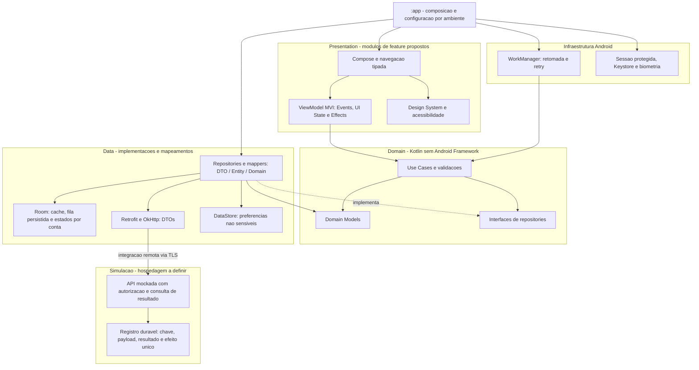
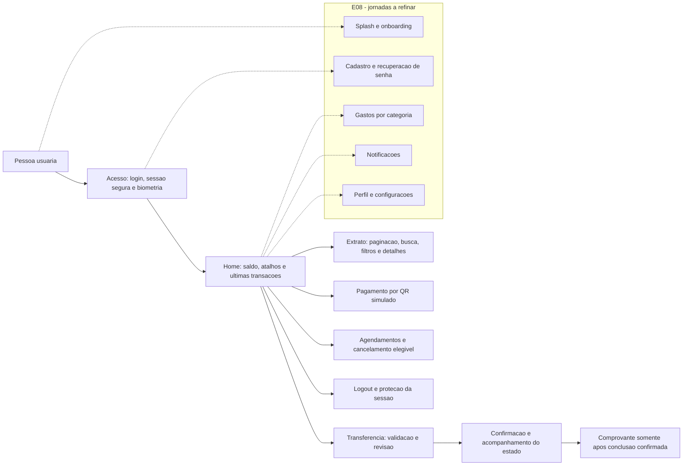
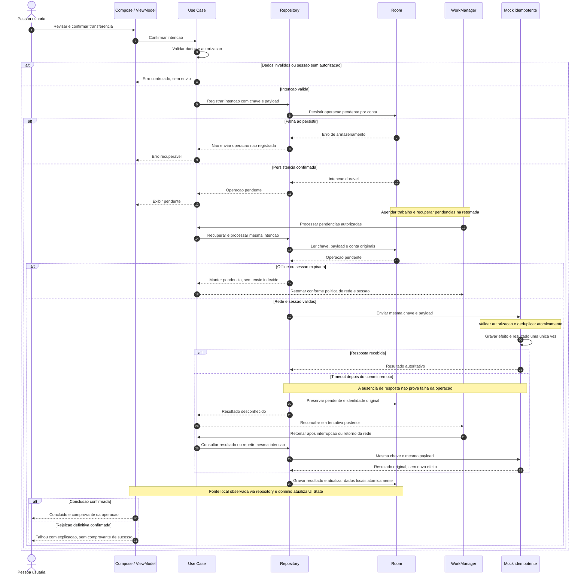

# Carteira Digital - Diagramas

## Contexto

Arquitetura alvo proposta com base em [conteudo.txt](conteudo.txt) e no [backlog](backlog.md). Nao representa funcionalidades ja implementadas: o projeto verificado parte de um scaffold Compose com apenas o modulo `:app`. As imagens do prototipo nao estavam disponiveis.

A carteira usa dados ficticios e API mockada, sem integracao bancaria real. Os limites de modulos, as politicas de sessao/cache/retry e o contrato do mock dependem de refinamento e ADR. Os nomes de modulos abaixo sao propostas, nao diretorios existentes.

## 1. Arquitetura Alvo

As setas neste diagrama representam dependencias de codigo ou uso de componentes. A seta tracejada de Data para os contratos significa implementacao das interfaces; Domain nao depende de Data nem de Android.

- UI observa `StateFlow` e emite Events; UI State e imutavel. Effects transitórios nao sao o registro duravel de operacoes.
- Room como fonte observavel da UI e uma proposta para offline-first. Sincronizacao atualiza a fonte local, que alimenta o estado via repository/Use Case.
- DTO, Entity e Domain Model sao separados. UI nao importa DAO ou API; interfaces Domain sao implementadas em Data.
- WorkManager e o adaptador de execucao persistente, nao garantia de execucao unica. A deduplicacao deve existir tambem no mock.
- Keystore protege chaves; armazenamento de segredos, backup e sessao exigem politica propria. DataStore e Room nao sao cofres automaticamente.
- Acesso biometrico e eventual autorizacao de transferencia dependem da politica aprovada; o desenho nao presume biometria obrigatoria em toda operacao.

Rastreabilidade: F03, F05, F07-F08; H00-H01, H03-H05 e HU02-HU04. A arquitetura e proposta de dependencia, nao uma chamada direta Domain -> Data.

## 2. Jornadas Funcionais

Setas representam agrupamento de capacidades, nao um prototipo de navegacao aprovado. Linhas tracejadas indicam jornadas apenas citadas no prototipo e ainda a refinar.

Rastreabilidade: F02/F04, HU01-HU21. As jornadas E08 nao estao excluidas, mas nao possuem regras suficientes para aceite executavel. Cache, loading, vazio e erros sao transversais; nao criar saldo ou comprovante ficticio para esconder uma falha.

## 3. Transferencia Offline e Idempotencia

Sequencia proposta para H04-H05 e HU10-HU12. A chave identifica uma intencao e deve ser persistida antes do envio. Uma nova tentativa da mesma intencao reutiliza chave e payload; uma nova intencao recebe outra chave.

O diagrama representa uma tentativa bem-sucedida de reconciliacao; novas falhas mantem a operacao pendente segundo a politica acordada. Se o processo morrer apos commit remoto ou antes de salvar a resposta, a chave persistida permite retomar a consulta sem criar outro efeito. Falha de gravacao local do resultado tambem exige reconciliacao, nao nova intencao.

Mesma chave com payload divergente deve ser rejeitada pelo mock. Logout ou troca de conta nao autoriza um Worker a enviar pendencias de outra identidade. Politicas de retry, retencao de chave, consulta de status e autorizacao offline permanecem abertas no backlog (D01-D02, D05-D06).

## Validacao Prevista

| Risco | Evidencia esperada | Backlog |
| --- | --- | --- |
| Timeout depois de commit ou envios concorrentes | Um unico efeito no saldo/extrato; resultado original na repeticao | H04, HU11 |
| Perda de rede e morte do processo | Mesma operacao/chave recuperadas, sem duplicacao | H05 |
| Sessao expirada, logout e troca de conta | Nenhum acesso ou envio por identidade indevida | HU02-HU04, H05 |
| Cache vazio/antigo e falha de atualizacao | Estados distintos, dados anteriores preservados | HU09 |
| UI e regras arquiteturais | Testes de Use Case/ViewModel/Compose; Domain sem Android; UI sem DAO/API | H01, H03, H06 |
| Dados sensiveis e acessibilidade | Sem segredos em logs/backup; TalkBack, foco, contraste e fonte ampliada | H07-H08 |

Entrega prevista: dev/stg/prod -> pipeline com build, testes, Detekt e Android Lint -> relatorio de cobertura e APK rastreavel -> avaliacao e demonstracao. Configuracao exata de distribuicao pelo Firebase ainda depende de D08; Crashlytics e Analytics sao previstos com dados sanitizados. Fonte pede cobertura de 50%; o padrao metodologico pede >80%, conflito a resolver em D07 sem substituir silenciosamente o requisito.

Estes diagramas sao documentacao de projeto. Nao comprovam compilacao, implementacao, execucao dos testes nem fidelidade visual ao prototipo.